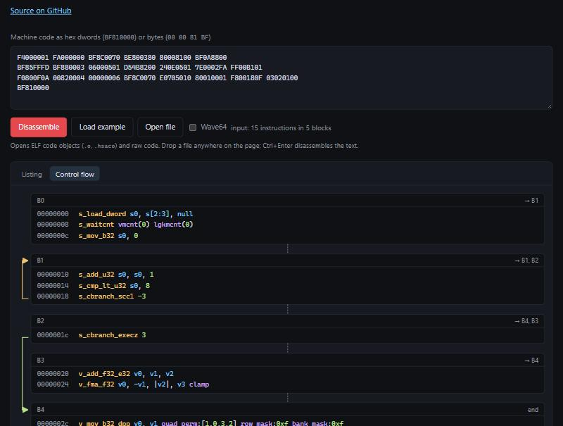

# rdna2-dis

[](https://github.com/booomxd/rdna2-dis/actions/workflows/ci.yml)
[](https://booomxd.github.io/rdna2-dis/)
[](https://github.com/booomxd/rdna2-dis/releases/latest)
[](LICENSE)

A disassembler and control-flow visualizer for AMD RDNA2 (gfx10.3) GPU machine code, written in Rust. It decodes every RDNA2 instruction format, prints assembly exactly as `llvm-objdump` does, and builds the control-flow graph of a shader. It runs as a command-line tool and, compiled to WebAssembly, in the browser.

**[Try it in your browser →](https://booomxd.github.io/rdna2-dis/)** Paste hex or drop a code object. Nothing is uploaded.



## Features

- **Complete instruction coverage.** All RDNA2 encodings (SOP1/SOP2/SOPC/SOPK/SOPP, SMEM, VOP1/VOP2/VOPC/VOP3/VOP3P, VINTRP, DS, MUBUF/MTBUF, MIMG, EXP, FLAT/GLOBAL/SCRATCH) and about 1,100 opcodes, generated from AMD's machine-readable ISA specification rather than typed by hand.
- **LLVM-identical output.** Registers and ranges, inline and literal constants, VOP3/VOP3P modifiers, DPP16/DPP8/SDWA, memory offsets and cache flags, MIMG `dmask`/`dim` with NSA addresses, export targets, and named operands: `s_waitcnt`, `hwreg(...)`, `sendmsg(...)`, `s_waitcnt_depctr` fields and buffer formats.
- **Verified against LLVM.** CI assembles test programs with `llvm-mc` and fails if any line `rdna2-dis` prints differs from `llvm-objdump`.
- **Control-flow graph.** Splits code into basic blocks at branches and branch targets, with taken, fall-through and back edges. Exported as Graphviz DOT from the CLI and drawn in the web UI.
- **Reads real code objects.** Takes AMDGPU ELF files (`.o`, `.hsaco`) and disassembles their `.text` section with symbol labels and named branch targets, or raw code blobs.
- **Wave32 and wave64.** Lane masks print as `vcc_lo`/`s0` or `vcc`/`s[0:1]`.
- **Small.** The decoder crate has no dependencies, and the WebAssembly build is under 200 KB.

## Example

```
$ rdna2-dis shader.bin
00000000: s_load_dword s0, s[2:3], null                                // F4000001 FA000000
00000008: s_waitcnt vmcnt(0) lgkmcnt(0)                                // BF8C0070
0000000c: v_fma_f32 v0, -v1, |v2|, v3 clamp                            // D54B8200 240E0501
00000014: buffer_store_dword v0, v1, s[4:7], 0 offen offset:16 glc     // E0705010 80010001
0000001c: image_sample v[0:3], [v4, v6], s[8:15], s[16:19] dmask:0xf dim:SQ_RSRC_IMG_2D // F0800F0A 00820004 00000006
00000028: s_endpgm                                                     // BF810000
```

## Installation

Download a prebuilt binary for Linux, Windows or macOS from the [latest release](https://github.com/booomxd/rdna2-dis/releases/latest), or build from source with a recent stable Rust toolchain:

```
cargo install --git https://github.com/booomxd/rdna2-dis rdna2-dis
```

## Usage

```
rdna2-dis [--wave64] [--dot] <code.o | code.hsaco | code.bin>
```

| Option | Effect |
|---|---|
| `--wave64` | Print lane masks for 64-lane waves (`vcc`, `s[0:1]`). The default is wave32. |
| `--dot` | Print the control-flow graph in Graphviz DOT instead of the listing. |

Render a control-flow graph with Graphviz:

```
rdna2-dis --dot shader.o | dot -Tsvg -o cfg.svg
```

To get a code object, compile a kernel for an RDNA2 target, for example `clang -target amdgcn-amd-amdhsa -mcpu=gfx1030 -c kernel.cl`.

### As a library

The `rdna2-isa` crate holds the decoder:

```rust
let code = rdna2_isa::elf::code(&file)?;                 // .text of an ELF, or the raw bytes
let mut lines = rdna2_isa::disassemble(code.bytes, false); // wave32
rdna2_isa::name_targets(&mut lines, &code.symbols);       // `s_branch done`
let cfg = rdna2_isa::blocks(&lines, &[]);                 // basic blocks and their edges
for line in &lines {
    println!("{:08x}: {}", line.offset, line.text);
}
```

## How it works

```
AMD ISA XML ──xtask──▶ generated.rs ──▶ rdna2-isa ──┬──▶ rdna2-dis   (CLI)
(GPUOpen, MIT)         formats, opcodes, decode,     └──▶ rdna2-wasm  ──▶ web/ (GitHub Pages)
                       operand lists     print, CFG
```

| Path | Contents |
|---|---|
| `xtask/` | Generator that reads AMD's ISA XML and writes the encoding and opcode tables. |
| `crates/rdna2-isa/` | Decoder: format detection, instruction length, operand printing, control flow, ELF reading. |
| `crates/rdna2-dis/` | Command-line tool. |
| `crates/rdna2-wasm/` | WebAssembly bindings for the web UI. |
| `web/` | The web UI: plain HTML, CSS and JavaScript, with no framework or bundler. |
| `tests/asm/` | Assembly programs that CI checks against `llvm-objdump`. |

Decoding is table-driven. Each encoding is identified by its fixed bits; where encodings overlap, the most specific mask wins. An instruction's length follows from its format and operands: literal constants, DPP and SDWA control words, and extra MIMG address dwords. Operand types and order come from the specification, and the printing follows LLVM's conventions.

## Testing

```
cargo test --workspace
bash tests/llvm/check.sh   # needs llvm-mc and llvm-objdump with the AMDGPU backend
```

- Unit tests cover decoding, instruction lengths, operand names, control-flow construction, ELF parsing (including malformed and truncated files) and the WebAssembly interface.
- `tests/llvm/check.sh` assembles every file in `tests/asm/` with `llvm-mc` for gfx1030, disassembles the object with both `llvm-objdump` and `rdna2-dis`, and diffs every instruction and label line. Files named `*.wave64.s` are checked in wave64 mode. CI runs it on Ubuntu, whose LLVM packages include the AMDGPU backend.

## Limitations

- RDNA2 (gfx10.3) only. RDNA1 and RDNA3 use different encodings.
- MIMG address counts assume 32-bit addresses; 16-bit addresses (A16/G16) are not accounted for.
- DPP16 and SDWA source modifiers (`neg`, `abs`, `sext`) are not printed.

## Regenerating the tables

Download AMD's machine-readable ISA specification from [GPUOpen](https://gpuopen.com/machine-readable-isa/), then:

```
cargo run -p xtask -- path/to/amdgpu_isa_rdna2.xml
```

This rewrites `crates/rdna2-isa/src/generated.rs`.

## Building the web UI

```
rustup target add wasm32-unknown-unknown
cargo install wasm-bindgen-cli --version 0.2.130
cargo build -p rdna2-wasm --release --target wasm32-unknown-unknown
wasm-bindgen --target web --no-typescript --out-dir web/pkg target/wasm32-unknown-unknown/release/rdna2_wasm.wasm
python -m http.server -d web
```

Every push to `main` deploys it to GitHub Pages.

## Roadmap

- [x] Opcode tables generated from AMD's machine-readable specification
- [x] Operands and modifiers in `llvm-objdump`'s spelling, checked line by line in CI
- [x] ELF code objects with symbols
- [x] Wave32 and wave64
- [x] Control-flow graph (CLI and web)
- [x] Web UI and live demo
- [x] Prebuilt releases
- [ ] Register liveness and EXEC-mask regions
- [ ] RDNA3 (gfx11)

## License

MIT, see [LICENSE](LICENSE). The instruction tables are generated from AMD's machine-readable ISA specification, © Advanced Micro Devices, Inc., also under the MIT license. The repository contains no AMD or third-party binaries.
